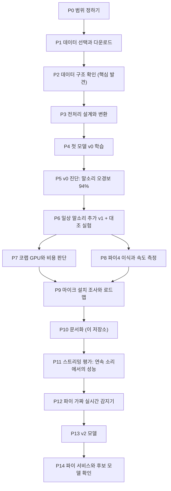

# 01. 시간순 진행 기록 (Timeline)

> 읽는 법: 각 단계는 **한 일 → 왜(판단 기준) → 결과(숫자) → 다음** 순서입니다.
> 날짜는 작업 기록(대화, 시스템 시각)으로 추정한 값이며, 정확한 시각을 남기지 못한 구간은 `(추정)`으로 표시했습니다.
> 결정의 근거와 대안은 [02_DECISIONS](02_DECISIONS.md), 숫자의 정의는 [GLOSSARY](GLOSSARY.md)에 있습니다.

## 한눈에 보기



| 단계 | 날짜 | 핵심 질문 | 한 줄 결과 |
|---|---|---|---|
| P0 | 11/01 | 마이크 없이 무엇을 할 수 있나 | 데이터와 모델을 먼저, 파이는 파일 기반으로 |
| P1 | 11/01 | 어떤 데이터를 쓰나 | AI Hub 위급상황 음성/음향 중 5개 클래스 |
| P2 | 11/01 | 데이터가 문서대로인가 | **아니었음**: wav는 이미 잘려 있고, 정상 데이터에 말소리가 없음 |
| P3 | 11/01~02 (추정) | 모델에 맞게 어떻게 바꾸나 | 16kHz 모노, 4초 창, 약 3.8GB |
| P4 | 11/01~02 (추정) | 첫 모델이 되나 | v0: AUC 0.993 (하지만 쉬운 문제) |
| P5 | 11/02 (추정) | v0는 정말 믿을 만한가 | **일반 말소리의 95%를 위급으로 판단** |
| P6 | 11/02 (추정) | 일상 말소리를 넣으면 | 오경보 87.9% → 0.9%, 재현율 유지 |
| P7 | 11/02 | 유료 GPU가 필요한가 | 지금은 불필요, 마이크 후 막히면 일회 구매 |
| P8 | 11/02 | 파이4에서 실시간이 되나 | 판단 한 번에 약 14~21ms |
| P9 | 11/02~03 | 마이크 후 무엇을 하나 | 설치 순서와 전/후 로드맵 |
| P10 | 11/03 | 팀이 따라올 수 있게 | 이 문서들 |
| P11 | 11/03 | 연속 소리에서도 되나 | **창 단위 93%가 연속 환경에서는 약 26~30%** (오경보 목표 준수 시) |
| P12 | 11/03 | 파이에서 연속 실행이 되나 | 판단 한 번에 21.5ms (실시간의 4.3%) |
| P13 | 11/04 | 약점을 겨냥하면 나아지나 | 엄격 기준 감지율 **0.26 → 0.40~0.48** |
| P14 | 11/04 | 규칙·클립·JSON이 파이에서 되나 | 되고, 후보 모델은 판단 23~55ms |

---

## P0. 범위 정하기 (11/01)

**한 일**
- 음성 파트의 목표를 정했습니다: 위급 음성 감지 → **앞뒤 약 10초 클립을 앱으로 전달**해서 사람이 실제로 확인할 수 있게 합니다. 화자 식별(등록된 사람 이름과 시간 전달)은 **확장 목표**로 둡니다.
- 제약을 정리했습니다: 마감 12월 중순, 최종 장비 라즈베리파이5, 지금 가진 건 라즈베리파이4, 마이크(reSpeaker 2-Mics Pi HAT V2.0)는 **빨라도 11/14 이후** 도착.
- 진행 방식: 딥러닝 개념(이미지)과 대응시켜 하나씩 이해하면서 진행합니다.

**왜 (판단 기준)**
- 마이크가 없어도 가능한 일(데이터, 모델, 파이 파이프라인, 속도 측정)을 먼저 끝내서, 마이크가 오면 **검증과 보정**에만 집중하도록 했습니다.

**결과**: 마이크 전/후 작업 분리의 첫 초안. (최신 버전은 [07_ROADMAP](07_ROADMAP.md))

## P1. 데이터 선택과 다운로드 (11/01)

**한 일**
- 후보 조사: AI Hub **위급상황 음성/음향 데이터(088)**. 문서상 16개 클래스, 구축량 3,559시간(목표 3,500시간), WAV+JSON 쌍.
- 우리 목적(독거노인 집 안의 위급 음성)에 맞는 클래스를 골랐습니다.
  - 위급: **도움요청, 응급의료, 낙상**
  - 정상: **실내, 실외** (생활 소음)
- 다운로드: AI Hub의 선택 다운로드로 Training/Validation × 라벨/원천을 받았습니다. 전체(수백 GB)가 아니라 필요한 것만 받았습니다.
- 다운로드 도구 비교: 제공되는 `aihubshell` 스크립트를 읽어 보니 (1) API 키가 필요하고 (2) **Ctrl+C를 누르면 받던 파일을 지우며** (3) 임시로 파일 크기의 2~3배 디스크가 필요해서, 20~30GB 파일에는 **웹의 이어받기 도구(INNORIX)**를 쓰기로 했습니다.

**왜 (판단 기준)**
- 프로젝트 목표와 직접 관련된 클래스만 사용, 나머지(화재, 범죄 등)는 보류.
- 디스크는 충분(약 1.5TB)했지만 시간과 코랩 업로드 용량이 한계라서 선택 다운로드.

**결과**: Training 원천 낙상 6.23GiB, 도움요청 20.97GiB, 응급의료 29.00GiB, 실내 29GiB×5, 실외 3개 파일. Validation 원천 낙상 0.36, 도움요청 0.58, 응급의료 4.61, 실내 12.61, 실외 5.98GiB. (용량 단위는 AI Hub 표기 GiB)

## P2. 데이터 구조 확인 — 가장 중요한 발견들 (11/01 저녁)

**한 일**
- zip 안의 JSON과 wav를 압축을 풀지 않고 직접 읽는 확인 스크립트로 구조를 검증했습니다. ([code/scripts](../code/scripts))

**발견 (모두 실측)**

| # | 발견 | 의미 |
|---|---|---|
| 1 | JSON 1개 ↔ wav 1개, wav 이름 = JSON 이름 + `_label.wav`. 낙상 18,322, 도움요청 40,735개가 정확히 일치. 응급의료는 라벨 46,901 vs wav 46,897 (4개 불일치) | 이름으로 짝지으면 됨, 4개는 제외 |
| 2 | **wav 길이 ≈ JSON `area`(이벤트 구간) 길이** (표본 200개에서 ±15% 이내 100%, 응급의료 98%). JSON `duration`(24~29초)은 원본 녹음 길이 | **wav는 이미 이벤트만 잘려 있음. `area`로 다시 자르면 안 됨** |
| 3 | 헤더 샘플레이트 44.1/48/96kHz, 1·2채널, 16·32bit 혼재. JSON은 전부 "44.1Khz"로 기록 | **헤더를 신뢰, JSON의 값은 믿지 않음** |
| 4 | 위급 3종은 전부 `voice`, 정상(실내/실외)은 전부 `sound` (말소리 없음) | **"말소리가 있으면 위급"이라는 지름길 위험** |
| 5 | 문구 쏠림: 낙상의 47%가 "미끄러졌어요"(샤워 소리 배경), 도움요청의 약 90%가 실외 녹음 | 문구별 상한으로 균형 맞춤 |
| 6 | Validation이 Training과 분포가 다름 (낙상 Val은 97% 여성·전원 성인) | 검증 점수의 의미가 제한적 |
| 7 | 모든 녹음이 같은 태블릿(갤럭시탭S6), 연기·제작 데이터 | 실제 마이크·실제 상황과 차이 가능 |

**왜 (판단 기준)**: 문서만 믿지 않고, **실제 파일에서 검산**한 뒤 전처리를 설계합니다. (정정 이력은 [09](09_CORRECTIONS_AND_LESSONS.md))

**결과**: 전처리 규칙의 근거 확정, 지름길 위험 목록 확보. → P3

## P3. 전처리 설계와 변환 (11/01~11/02, 추정)

**한 일**
- 규칙: **16kHz 모노**(헤더 기준으로 변환), **4초 창**, 위급 클립이 4초보다 짧으면 반복해서 채움, 문구(note)당 최대 40클립, 정상은 소음 종류별로 돌아가며 선택, 위급:정상 = 1:1.
- `plan`(규모 확인) 후 `run`(변환) 2단계로 실행. 10분 소요.
- 변환 결과를 점검하고 직접 들어 봤습니다.

**결과**

| 세트 | 위급 | 정상 |
|---|---|---|
| Training | 10,664창 | 10,682창 |
| Validation | 4,277창 | 4,282창 |

- 총 29,905창, 약 3.8GB. 길이가 맞지 않아 빠진 클립 20개.
- 점검에서 드러난 점: 위급이 정상보다 약 10dB 큼(-24 vs -33.8 dBFS), 위급 창의 48%가 반복으로 채운 창, 근접 녹음의 8~12.8%가 찌그러짐 근처.
- 청취: **반복으로 채운 창은 같은 말이 되풀이되다 끊겨 어색**했습니다. → **학습에서는 반복 구간을 쓰지 않고 실제 소리가 있는 구간에서만 2.5초를 자르기로** 했습니다 (2.5초 미만 클립은 제외, 약 5%).

## P4. 첫 모델 v0 (11/01~11/02, 추정)

**한 일**
- 구조: 로그멜(64×251) → 4블록 CNN(6만 파라미터). 학습: 소음 얹기, 음량 무작위, SpecAugment, 에폭마다 위급:정상 균형, 20에폭.
- 코랩 T4에서 337초.
- 문제: 코드를 한 번에 붙여 넣다가 **약 10,300자에서 잘려** 오류 → 셀을 5,000자 이하로 분할.

**결과**: AUC 0.993, 재현율 0.962, 오경보 3.2%, 1% 오경보 기준 재현율 0.935.
**하지만** 정상에 말소리가 없어서 "말소리 유무"만으로도 풀리는 쉬운 문제입니다. 이 점수를 성능으로 믿지 않기로 했습니다. → P5

## P5. v0 진단 — 지름길 확인 (11/02, 추정)

**한 일**
- 공개 한국어 낭독 음성(Zeroth-Korean, CC BY 4.0)을 받아 **일상 말소리 시험 세트**로 만들었습니다 (시험 화자 10명은 학습 화자와 겹치지 않음).
- 다운로드가 중간에 끊긴 파일(8.46GB, 실제 10.34GB)로 오류가 났고, 서버 크기를 확인해 **이어받기**하도록 고쳤습니다. 진행률 표시도 추가.
- v0에 여러 탐침 시험을 적용했습니다 (소음 위 말소리, 말소리 길이와 위치, 음량, 합성음).

**결과 (v0)**

| 시험 | 결과 |
|---|---|
| **일반 말소리 오경보** | **94.5%** (기준 0.5), 1% 기준에서도 87.9% |
| 소음 위 말소리 재현율 | 20dB 0.93, 10dB 0.91, 5dB 0.87, **0dB 0.70, -5dB 0.42** |
| 짧은 말소리(10dB) | 0.5초 약 0.5, 1초 약 0.73, 2초 약 0.89. 창 안 위치(앞/가운데/뒤)는 영향 거의 없음 |
| 합성음 6종 | 모두 0.00 (단순한 소리엔 반응 안 함) |

**판단**: v0는 위급이 아니라 **말소리 유무**를 주로 본다. 정상에 일상 말소리를 넣어야 한다. → P6

## P6. v1 학습과 대조 실험 (11/02, 추정)

**한 일**
- v1: 정상에 일상 말소리(낭독, 소음을 섞어서)를 추가. 같은 시험을 반복.
- 대조 실험 3개: 문구 20%를 학습에서 제외, 노인(senior) 클립 전부를 제외. (v0 방식 문구 제외도 비교)

**결과** (정상 소음 오경보 1% 기준)

| 항목 | v0 | v1 |
|---|---|---|
| 일반 말소리 오경보 | 87.9% | **0.9%** |
| 소음 섞은 말소리 오경보 | 89.1% | **1.7%** |
| 위급 재현율 | 94.1% | 93.1% |
| 소음 위 0dB 재현율 | 0.70 | 0.63 |
| 1초 말소리 재현율 | 0.74 | 0.70 |

| 대조 실험 | 학습에서 뺀 부분의 재현율 | 일반 검증 재현율 |
|---|---|---|
| v1, 문구 20% 제외 | 0.927 | 0.926 |
| v1, 노인 클립 제외 | 0.937 | 0.927 |

**판단**
- 일반 말소리 지름길이 크게 깨졌고, **처음 보는 문구와 노인 목소리에서도 재현율이 유지**됩니다 (키워드 암기가 아님).
- 대가: 짧은 외침과 큰 소음에서 재현율이 약간 내려갔고, **공사장 소리 오경보가 9.9% → 17.1%로 늘었으며**, 차분하게 상황을 설명하는 응급 문장("가슴 통증이 심해요" 0.634 → 0.561 등)이 약해졌습니다.
- 낙관적일 수 있음: 정상 말소리는 조용한 곳의 낭독, 위급은 연기 → "읽는 말투 vs 연기하는 말투"를 배웠을 가능성. **실제 TV·라디오·대화로 검증 필요(마이크 후)**.

## P7. 코랩 GPU와 비용 판단 (11/02)

**배경**: 코랩 무료 GPU가 한때 막힘.
**조사**: 무료 한도는 비공개·변동. 유료는 **Pay As You Go $9.99 = 100 컴퓨트 유닛(일회, 구독 아님, 유닛 90일 후 만료)**, Pro는 월 $9.99. T4는 시간당 약 1.2~1.8유닛이라 100유닛이면 약 57~84시간(자료마다 다름). 유료여도 GPU가 보장되지는 않음. (조회 시점 기준, 변동 가능)
**분석**: 우리 학습은 1회 약 5분, 향후 GPU 총 2~3시간 예상. 에폭당 15초(초당 약 1,350샘플)는 GPU 이론 성능의 일부만 쓰는 값이라, **병목은 CPU의 데이터 가공**일 가능성(추정, `nvidia-smi`로 확인 가능).
**결정**: 지금은 결제하지 않는다. **마이크 도착 후 하루 안에 여러 번 재학습해야 하는데 GPU가 안 잡히면 그때 일회 구매**. 실험은 모아서 한 번에 돌리고 결과는 즉시 드라이브에 저장 (이어하기 구조).

## P8. 파이4 이식과 속도 측정 (11/02)

**한 일**
1. 모델을 **ONNX**로 내보내고 특징 추출은 **numpy**로 구현. 학습 때 쓴 PyTorch와 결과가 같은지 검산: 특징 차이 7.0e-06, 확률 차이 2.1e-07 (사실상 동일).
2. 파이4: 64비트 OS 확인, 가상환경, 패키지 설치. 코랩에서 만든 파일 3개(`.onnx`, `mel_fb.npy`, `config.json`)를 `scp`로 복사.
3. 속도 측정 스크립트 실행.
4. SSH 접속 연습: 설정은 되어 있었으나 한때 시간 초과 → 원인은 파이가 막 켜진 상태였을 가능성(추정, 서비스 시작이 확인 8분 전). 같은 네트워크와 IP 일치를 확인한 뒤 재접속 성공.
5. 마이크 설치 전 점검(OS, I2C, 디스크, 시간 동기화, 오디오 장치 등).

**결과**: 모델 파일 238.5KB. 판단 한 번에 **특징 8.2ms + 모델 12.9ms(1스레드)=21.3ms (p95)**, 4스레드 14.4ms. 0.5초마다 판단해도 23배 이상 여유. 온도 46.7→55.0°C, 성능 제한 없음. 자세한 내용은 [05_RASPBERRY_PI](05_RASPBERRY_PI.md).

## P9. 마이크 설치 조사와 로드맵 (11/02~11/03)

**한 일**: Seeed 공식 위키(V2 문서)를 읽고 파이 환경(Debian 13, 커널 6.18)과 대조해 설치 순서를 정리. 마이크 전/후 작업을 분리해 체크리스트와 일정 작성. ([07_ROADMAP](07_ROADMAP.md))
**핵심 판단**: v1용 구형 드라이버 설치법은 최신 OS에서 데스크톱을 망가뜨릴 수 있다고 안내되어 있으므로 **V2 문서만 따른다**.

## P10. 문서화 (11/03)

이 저장소의 문서를 작성했습니다. 이후에는 아래 형식으로 **이 파일 맨 아래에 이어서** 기록합니다.

```markdown
## Pxx. 제목 (YYYY-MM-DD)
**한 일** / **왜(판단 기준)** / **결과(숫자와 조건)** / **다음**
```

## P11. 스트리밍 평가: 연속 소리에서의 성능 (11/03)

**한 일**
- 실제 장비처럼 소리를 계속 받으며 0.5초마다 판단하는 조건을 흉내 내기 위해, 검증용 소음 창을 이어 붙여 **60분짜리 스트림 3개**를 만들었다: 소음만(`neg`), 소음+일상 말소리 394개(`speech`), 소음+말소리 205개+위급 문장 110개(`urg`). 위급 문장은 원래 크기, -6, -12, -18dB로 재생해 거리를 흉내 냈다.
- 파이와 같은 방식(numpy 특징 + ONNX)으로 v1을 돌리고, 기준값 10가지 × 연속 횟수 4가지 × 소리 크기 게이트 5가지 = 200개 규칙을 비교했다. (코드: [code/colab](../code/colab) 셀 S0~S6)

**왜 (판단 기준)**: 창 하나씩의 점수는 시간당 오경보를 알려 주지 못한다(원칙 D). 판단은 하루 86,400번 일어난다.

**결과** (표는 [04 §8](04_MODEL_EXPERIMENTS.md))
- 창당 1% 오경보였던 기준값(0.882, 연속 1회)에서 **시간당 오경보 18회(소음), 40회(말소리)**, 감지율 49%.
- 오경보를 시간당 1~3회로 묶으면(기준값 0.999) **감지율 약 25~30%**, 감지 지연 중앙값 2~3초.
- 재생 크기별 감지율(오경보 목표를 지키는 규칙): 원래 크기 0.50, -6dB 0.33, -12dB 0.26, -18dB 0.11.
- 원래 크기의 문장도 **27%는 어떤 창에서도 확률 0.882를 넘지 못했다**.
- 오경보 위치: 소음에서는 큰 소리 구간(창 크기 중앙값 -18dBFS, 전체 -35), 말소리에서는 말소리와 겹친 구간(80%, 전체 49%).
- **시험 신호의 클리핑은 원인이 아니었다**(잘린 샘플 0.0008% 이하). 스트림에서 합친 신호가 최대치를 넘은 구간(peak 1.11, 1.52)이 있었지만 영향은 거의 없었다.

**판단**: 창 단위 점수(재현율 93%)는 연속 환경의 성능을 크게 과대평가했다. v1은 파이 프로그램 시험용으로는 충분하지만 **실제 알림용으로는 부족**하다. v2 학습이 필요하고, 규칙의 초기값은 v2 이후에 다시 정한다.

## P12. 파이 가짜 실시간 감지기 (11/03)

**한 일**: wav 파일을 마이크처럼 0.5초씩 흘려 보내고 최근 2.5초를 판단하는 프로그램(`code/scripts/detector.py`)을 파이4에서 실행했다. 입력은 스트리밍 평가의 앞 10분 조각(위급 문장 18개).

**결과**
- 1,196개 창을 판단하는 데 한 번에 평균 21.5ms (p95 22.5ms), **실시간의 4.3%** (1스레드). 앞서 잰 속도와 같다.
- 코랩과의 확률 차이는 최대 1.84e-03 (시각 차이 0). 처음 정한 기준(1e-4)보다 크다. 실제 영향은 작지만(확률이 기준값의 0.002 안쪽일 때만 판정이 바뀜) **원인은 확인하지 못했다**. 가설: 조용한 구간에서 부동소수점 차이가 표준화 단계에서 커짐. (미해결, [07](07_ROADMAP.md) A1b)
- 임시 규칙(기준값 0.95, 연속 3회, 쉬는 시간 10초): 경보 8번, 위급 문장 18개 중 5개 감지(28%), 지연 중앙값 2.4초, 문장 밖 경보 2번. 코랩 평가에서 예상한 맞바꿈과 비슷한 수준.
- 터미널에 긴 코드를 붙여 넣었더니 중간이 사라졌다 → **스크립트는 파일로 만들어 `scp`로 보낸다**.

**다음**: 판단 규칙과 앞뒤 10초 저장(A2, A3)을 감지기에 붙인다. 모델 개선(v2)은 병행.

## P13. v2 모델: 스트리밍 평가로 드러난 약점 겨냥 (11/04)

**한 일**
- v1 방식에서 바꾼 점: (1) 위급 문장을 소음보다 작게(-10~20dB) 학습, (2) 창 일부에만 소리가 있는 조각을 양성·음성 모두에 삽입(40%), (3) **어려운 오답 채굴**: v1이 위급이라고 잘못 판단한 소음·일상 말소리(Training 쪽 데이터로 4,000개)를 음성에 25% 섞음, (4) v1이 소음 속에서 놓친 위급 문장을 양성의 30%로 재학습, (5) 40에폭, 체크포인트 매 에폭 저장.
- 5개 변형을 한 번에 학습: `v2_hard`(전체), `v2_no_hn`(채굴 뺌), `v2_no_part`(조각 삽입 뺌), `v2_wide`(네트워크 약 4배), `v3_round2`(v2로 채굴 한 번 더).
- 무료 T4 GPU에서 **5개가 1시간 30분 안에 끝났다**(모델당 모델 평가는 CPU 약 2.5분, wide는 4.5분).
- 같은 60분 스트림 3개로 v1을 포함한 6개 모델을 한 표로 비교했다(코드: 셀 8a~8d, E1).

**결과** (오경보 한도 안에서의 최고 감지율, 표는 [04 §9](04_MODEL_EXPERIMENTS.md))
- 엄격(소음 시간당 1회, 말소리 3회 이하): v1 0.26 → v2 **0.40~0.48** (wide 0.48, no_part 0.45).
- 완화(5회, 10회 이하): v1 0.35 → v2 **0.49~0.54**.
- 창 단위 점수는 모든 모델이 0.934~0.941로 거의 같았다 → **창 단위 평가로는 모델 차이가 보이지 않는다**.
- v2끼리의 차이(채굴 유무, 조각 삽입 유무, 채굴 2회)는 시험 오차(이벤트 110개, 약 ±0.05) 안이다. 개선은 v2 모두가 공유한 부분(조용한 소리까지 학습, 40에폭, 놓친 문장 재학습)에서 온 것으로 보이나, 개별 효과는 구분하지 못했다(추정).

**판단**: v2는 v1보다 확실히 좋아졌지만 절대 수준은 아직 낮다. 마이크 도착 전까지 모델을 더 만지지 않고, 실제 마이크 데이터로 개선한다.

## P14. 파이 서비스(규칙·클립·JSON)와 후보 모델 확인 (11/04)

**한 일**
- `code/scripts/urgent_service.py`: 판단 규칙(기준값, 연속 횟수, 소리 크기 게이트, 쉬는 시간), 최근 10초 + 이후 10초 클립 저장, 앱용 JSON, 저장 개수 제한과 디스크 보호, 마이크 입력 경로(파일을 파이프로 흘려 확인, 실제 마이크는 도착 후).
- 파이4에서 10분 스트림으로 실행: 경보 8번, 8개 모두 20초 클립 완성, JSON 항목 정상, `time_synced: true`.
- ONNX 스레드를 기본값(4개)으로 두면 판단 한 번에 42ms, 1스레드는 23ms → **스레드 수를 설정(`threads`, 기본 1)으로 고정**.
- 후보 모델을 파이에서 실행: `v2_wide` 54.7ms(실시간의 약 11%), `v2_no_part` 23.1ms(약 4.6%).

**결정**: 파이 주 후보 `v2_wide`, 대체 `v2_no_part`. 기준값과 규칙은 실제 마이크 데이터로 다시 정한다.

---

## 다음 단계 (2026-11-04 기준)

1. **앱 연동**: 팀과 전송 방식 확정 → 전송 코드, 자동 시작과 재시도 (A5, A6)
2. **녹음 계획표·동의서·녹음 도우미** (C1~C4)
3. **마이크 도착(11/14 이후)**: 설치·검증 → 실제 녹음 → 실환경 평가에서 `v2_wide`와 `v2_no_part`를 다시 비교, 재학습, 기준값 조정
4. 파이와 코랩의 확률 차이 원인 확인 (A1b)
